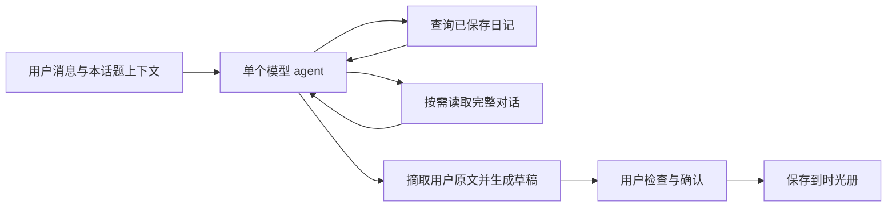

# Agent 设计审查与本轮优化

日期：2026-10-14。审查对象是本轮开始时的工作区版本，包含已有的未提交改动；这些改动被保留。本轮重点沿「用户输入 → 上下文 → 模型/工具 → 待确认草稿 → 保存 → 历史查询」检查逻辑，也检查了相关会话同步与照片保存。

## 结论

当前的单 agent、工具调用、用户确认保存、查询返回原记录引用，适合比赛 demo 和自用。主要问题在于：模型已经具备工具调用能力，但执行器仍以关键词决定是否允许查询、用当前句覆盖各次工具参数、只信当前句的记录依据。这会破坏正常的追问、多事件查询和跨轮记录。

建议继续维护小型 agent 循环，把语义选择交给模型，把真实数据读写和可验证边界留给代码。本轮据此完成修改，没有新增框架、数据库或多 agent。

## 与公开实践对照

| 公开实践 / 案例 | 适合借鉴的部分 | 本项目采用方式 |
|---|---|---|
| Anthropic《Building effective agents》 | 从简单方案开始，工具应有清楚的契约；复杂编排有额外延迟和成本 | 保持一个 agent 和少量工具，单请求六轮工具预算，加一次收尾 |
| Claude Code 的即时上下文检索 | 保留轻量目录和标识，需要时取回原文；上下文有限，不能把截断当成永久丢失 | 最近消息进入提示词，完整当前话题和历史话题通过分页工具读取 |
| Anthropic 的 Slack / Asana 工具迭代案例 | 减少重叠工具，返回有用的结构化数据，用真实任务评估工具使用效果 | 统一日记查询和近期回顾，补充分页与查询用途；新增可单独运行的真实模型场景评测 |
| OpenAI《A practical guide to building agents》 | 单 agent 是合理起点；工具权限与人工确认按动作风险设计 | 查询可自主执行；记录只生成草稿，正式写入继续由用户确认 |

这些是设计原则与案例对照，不代表本项目已经达到公开案例的规模或测评水平。

来源：[Anthropic 简单 agent 实践](https://www.anthropic.com/engineering/building-effective-agents)、[Claude Code 上下文实践](https://www.anthropic.com/engineering/effective-context-engineering-for-ai-agents)、[Slack/Asana 工具与评测案例](https://www.anthropic.com/engineering/writing-tools-for-agents)、[OpenAI agent 实践指南](https://cdn.openai.com/business-guides-and-resources/a-practical-guide-to-building-agents.pdf)。

## 发现与已做修改

| 问题 | 影响示例 | 修复 |
|---|---|---|
| 查询工具受当前句关键词开关控制 | 前面问过驱虫，再问「那疫苗呢？」可能被拦截 | 移除查询执行前的关键词门禁，让模型结合上下文决定 |
| 每次查询都由同一句原话重新覆盖事件与范围 | 「驱虫和疫苗分别什么时候」可能把两个工具调用都改成同一事件 | 正常工具与 JSON 查询直接使用模型参数，程序校验日期、范围和类型 |
| 提示词禁止含明确指代的「把刚才的记下来」，记录依据也只有当前句 | 前文已经说了洗澡，后续记一下仍追问；rawInput 只剩指令 | 允许引用本话题用户事实；sourceText 摘取原文，代码验证出处，保留完整事实来源消息 |
| 用否定词加双字重叠推断草稿事实 | 「没想到今天驱虫这么顺利，没有不良反应」被误拦 | 移除这类语义拦截，由模型理解否定、计划与事实，代码只验证原文出处 |
| 多日期混合句取第一个日期 | 「昨天没洗澡，今天洗了澡」可能记成昨天 | 模型选择具体事实分句，再从该分句解析日期；仍有多日期时留空 |
| 重新打开旧会话时相对日期使用本次今天 | 旧消息的「昨天」被解释成现在的昨天 | 完整话题携带消息日期，证据来自前文时以原消息发送日解析 |
| 八轮限制已被移除，但 4000 字符预算仍会无声省略；查询回复也被排除 | 长话题最初说的事取不回来，下一轮不知道刚查到了什么 | 默认改为 12000 字符预算，提供完整话题读取工具，查询回复进入历史 |
| 读取旧话题调用了会切换当前缓存的 openSession | agent 查个旧话题，本机当前会话槽位意外改变 | 分离只读 readSession 与用户打开动作 |
| 同步使用仅包含已上云照片的回包覆盖本机消息 | 刚发但还没保存的照片与重试信息丢失 | 同步成功只更新 id/版本，保留本机消息；恢复云端草稿时补回宠物 id |
| 用户消息和 AI 回复并发保存相同旧版本；迟到回包/标题可串话题 | AI 回复漏同步，旧标题或旧会话覆盖新会话 | 页面保存串行执行，结果按会话身份与家庭范围检查；标题绑定 clientId |
| 上传会话时静默取最后 100 条；删除当前话题又走收尾保存 | 历史悄悄消失，删除后还尝试同步旧话题 | 接近上限自动开新话题；超限明确报错；删除后直接建空会话 |
| 编辑照片后沿用旧 photoIds | 删除 A、保留 B 并加新图，保存时仍用了旧图 | 按编辑后的照片顺序重新对齐 fileId，新图走本机路径 |
| 工具错误被当成最终事实、三轮结束可能没有收尾 | 参数修好了，回复仍展示旧错误或空白 | 错误回灌模型修正；成功结果驱动展示，工具预算结束后明确收尾 |

相关实现：`utils/agent.ts`、`utils/draft.ts`、`utils/context.ts`、`utils/query.ts`、`utils/chat-store.ts`、`pages/chat/chat.ts`。协议与边界见 [查询、记录与话题上下文](query-and-tools.md)。

## 当前交互路径

事实查询默认直接展示程序生成的摘要和引用。回顾、比较、咨询使用 purpose=context，让模型结合原文回答，同时显示事实依据。这样既能保留模型推理能力，也能让用户回看记录。

## 保留的简单取舍与边界

1. **没有新增语义检索库。** 查询仍是关键词/标签检索。小数据量下模型可按日期列出日记、分页阅读后推理；几十上百条日记足够支撑 demo。若以后大量真实使用证明召回不足，再考虑轻量检索，不提前建设向量数据库。
2. **原文出处校验不等于语义证明。** 它能挡住不存在的引文、助手建议冒充用户原话；不能证明模型没有把否定改成肯定、改错数字或遗漏重要内容。这部分依赖提示词、模型评测和用户确认。
3. **日期继续保守。** 对解析不了的自然日期留空，用户点选。多个日期的事件仍建议分别记录，一轮最多一张卡；没有新增复杂批量草稿系统。
4. **记录条数不等于事件次数。** 一条日记可能包含几次喂食，当前不做事件拆分与自动事件计量。语义回顾不能冒充精确统计。
5. **话题仍有边界。** 30 分钟间隔自动新话题和 100 条文档上限仍存在，但不再静默裁掉云端消息。历史目录只提供最近十个其他话题；JSON 降级无法使用按需读取工具。这些限制已明确记录，没有宣称无限记忆。
6. **云同步保持 demo 规模。** 顺序提交和身份检查解决常见竞态；没有做实时推送、离线写队列、多人并发冲突合并。查询读同步缓存，不保证另一个家庭成员刚改完就立即反映。
7. **图片没有送入视觉模型。** 当前附件作为日记照片保存，纯照片输入直接生成照片草稿。模型不能据此判断图片里发生了什么。若比赛需要视觉理解，应作为独立的下一项功能。
8. **用户手动编辑正文仍用简单标签辅助。** 这不会决定是否允许记录；细粒度事件检索仍有漏匹配风险。原日记可编辑修正。

当前工作区的引导已要求云端登录与模型配置，旧 README 中「不配模型即可本地演示」已不符合实际。本轮更新文档反映现状，没有改回用户已有的交互选择。

## 验证记录

修改前：12 个测试套件、145 项模拟测试通过。它们没有覆盖本次发现的多个实际交互问题，个别测试还把「对咨询乱出草稿」当作默认可接受结果。

本轮补充：省略追问、多事件查询、工具错误修正、跨轮证据、助手建议隔离、混合日期、旧消息相对日期、超预算取回、历史只读、宠物归属、同步保留照片、顺序版本、迟到回包/标题、照片编辑、分页与存储上限等回归测试。

另提供 `npm run eval:agent`，使用合成数据通过正式 runAgent 调用用户指定的真实模型；后续补充日记正文整理与中文标签场景，现覆盖十四个自然交互场景。此次未提供用于评测的真实模型凭据，未执行付费模型调用；只检查了评测入口和类型。真实模型测试应在比赛所用服务与模型上运行，尤其检查否定/计划、跨轮记录和复合查询。

最终结果：TypeScript 类型检查通过；14 个测试套件、172 项测试全部通过，比修改前增加 27 项。真实模型评测入口已验证能被单独发现，不进入默认 CI。Node 验证不能替代微信开发者工具编译、真实云环境与真机照片/键盘交互验收。

后续交互修正：补清楚正文可自然整理、原文证据才要求逐字引用；30 分钟话题边界改在打开/恢复页面和停留到期时提前显示，保留未发送输入，主动打开旧话题从打开时重新计时。相应回归测试加入后，当前类型检查及 15 个套件、183 项测试通过。
