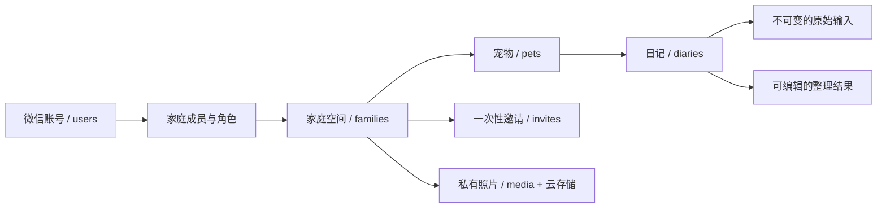

# 微信云开发后端与家庭共享

> 当前契约更新于 2026-10-17：交互要求云端登录；没有本机模式或旧数据导入入口。代码、部署及真机验收是不同状态，具体部署记录见 [开发记录](development-log.md)，本文不据本地实现推断线上版本。

提供 `diaryApi` 云函数、客户端接入、家庭管理入口与测试。已配置云环境 ID `cloud1-d5g3cyroib9fc6099`，通过「账号与家庭空间」连接云端。数据库规则和双微信账号验收仍需按下文执行。

## 1. 身份与登录

- 小程序不能读取用户的「微信号」字符串。使用云函数 `cloud.getWXContext()` 的 `APPID + OPENID` 区分当前微信账号，不依赖昵称、头像或用户填写的账号。
- `auth.login` 将其映射为稳定的内部 `userId`。首次登录在事务中创建用户和默认家庭；重复或并发登录不会重复创建。
- 已有账号退出或解散最后一个家庭后保持登录，`familyId` 为空；再次登录不补建默认家庭。前端进入家庭页创建或加入，完成后才可记录日记，模型配置保留。
- 「账号与家庭空间」页底部提供退出登录，离线或没有家庭时也可使用。确认后清除本机登录、当前账号全部家庭缓存 / 当前聊天 / 新手测试状态，重建页面栈进入欢迎页；默认保留模型配置，可选择同时清除。其他账号的缓存与本机开发者开关不受影响。
- 本机退出不调用 `family.leave / family.dissolve`，不删除云端日记、照片、已同步历史话题或家庭成员关系，也不注销微信账号 / 撤销微信调用身份。再次连接仍使用当前微信身份，不能据此模拟一个新微信账号。尚未保存的本机内容可能丢失，未在本轮实现永久媒体文件清理。
- 客户端登录代次在退出和身份 / 家庭变更时递增。旧登录、刷新、会话同步、测试家庭请求及页面标题 / 摘要回包不能恢复已清理的本机状态，即使之后登录的是相同账号和家庭。退出前已提交到服务端的操作仍可能完成，退出不宣称撤销已发出的云端写入。
- 前端 `wx.cloud.callFunction` 已携带微信调用身份，无需自己保存 JWT、AppSecret 或 session_key。前端发送的 `userId`、`openid`、`role` 均不作为身份凭证。
- OpenID 只保存在服务端 `users` 文档，不通过业务接口返回。昵称通过 `type="nickname"` 输入框由用户填写，仅作展示；头像不是登录前提。
- 可设置云函数环境变量 `WECHAT_APP_ID` 为当前小程序 AppID，进一步限制调用来源。它是公开标识，不是密钥。
- 同一微信在不同 AppID 下的 OpenID 不同，当前不做跨应用账号合并。未来需要微信开放平台统一账号时，可单独设计 UnionID 关联流程。

官方接口参考：[微信云函数调用与 getWXContext](https://docs.cloudbase.net/en/recipes/add-cloud-function-wechat-miniprogram)、[微信服务端 SDK 类型定义](https://github.com/wechat-miniprogram/wx-server-sdk/blob/master/index.d.ts)。

## 2. 数据归属



一只宠物属于一个家庭，家庭内多人共同记录。一个微信账号可以加入多个家庭，通过当前家庭切换数据范围。家庭之间不能引用对方的宠物、日记或照片。当前上限为每个用户 10 个有效加入的家庭（包括默认家庭）、每个家庭 20 位成员；退出、被移除或家庭解散时同步释放家庭名额。

| 集合 | 核心字段 | 作用 |
|---|---|---|
| `users` | `_id`, `appid`, `openid`, `nickname`, `familyIds`, `createdAt` | 微信身份映射；`familyIds` 是家庭列表索引，不作权限凭证 |
| `families` | `_id`, `name`, `members[]`, `revision`, `createdAt`, `updatedAt`, `dissolvedAt?`, `dissolvedBy?` | 权限的唯一依据；成员包含 `userId`, `role`, `joinedAt`；旧家庭缺少解散字段时视为有效 |
| `pets` | `_id`, `familyId`, `name`, `species`, `breed`, `birthday`, `createdBy`, `version`, `deletedAt` | 家庭共享的宠物档案 |
| `diaries` | `_id`, `familyId`, `petId`, `rawInput`, `formatted`, `formatting`, `createdBy`, `updatedBy`, `version`, 时间戳, `deletedAt` | 记录原文与整理结果 |
| `invites` | `_id`（token 哈希）, `familyId`, `createdBy`, `expiresAt`, `usedBy`, `usedAt`, `revoked` | 一次性、24 小时有效的加入凭证 |
| `media` | `_id`（fileID 哈希）, `fileId`, `familyId`, `uploadedBy`, `createdAt` | 照片所属家庭与访问验证 |
| `chat_sessions` | `_id`, `familyId`, `petId`, `userId`, `messages`, `title`, `summary`, `version`, `deletedAt` | 当前账号的个人话题，非家庭共享日记 |
| `media_uploads` | `_id`（服务端随机上传 ID）, `familyId`, `uploadedBy`, `stagingFileId`, `expiresAt`, `fileId?` | 临时上传授权与幂等确认；仅服务端读写 |

成员列表存于家庭文档，适合小型家庭。成员变更与用户家庭索引同时提交事务，避免出现「已退出但列表仍可访问」。若未来扩大到社群，应迁移到单独的 membership 集合，并重新设计角色与索引。

日记示例：

```json
{
  "_id": "d_...",
  "familyId": "f_...",
  "petId": "p_...",
  "rawInput": {
    "text": "今天早晨给点点洗了澡，乖乖的！",
    "photos": ["cloud://..."],
    "provenance": "direct"
  },
  "formatted": {
    "date": "2026-10-12",
    "text": "点点洗澡",
    "tags": ["洗澡"],
    "photos": ["cloud://..."]
  },
  "formatting": { "schemaVersion": 1, "mode": "tool" },
  "createdBy": "u_...",
  "updatedBy": "u_...",
  "version": 1,
  "createdAt": 1791792000000,
  "updatedAt": 1791792000000,
  "deletedAt": null
}
```

`rawInput` 首次确认保存时写入，后续编辑不得替换。当前聊天入口保留整理前的完整输入（包括首尾空白），草稿编辑只改 `formatted`。照片按微信选图返回的文件原样转存和上传，小程序内部不再压缩、缩放或重新编码；是否由微信选图器压缩取决于用户选图操作，不承诺取得相机底层原始文件。原始输入照片列表与整理结果照片列表分别保留，已经压缩保存的旧照片不会恢复画质。

`formatting.mode` 是客户端上报的整理方式：`local / model / tool / manual / legacy`，用于展示来源，不当作模型真实性的服务端审计证明。当前保存最新整理结果和版本号，尚未保留每次编辑的完整历史快照。

日期是用户确认的事件日期；时间戳由服务器生成，不能由客户端冒充。只在用户点击保存后写入家庭共享日记。聊天文字与未确认草稿文字随话题写入 `chat_sessions`，按账号、家庭、宠物隔离，仅当前账号可读，不向其他家庭成员共享。未保存日记的照片仅留当前设备；确认保存后才上传照片。模型 API Key 不上传到此后端。家庭成员能够查看已确认日记及其原始输入。

## 3. 权限与一致性

| 操作 | 家庭创建者 owner | 普通成员 member | 非成员 |
|---|---|---|---|
| 查看宠物、日记及原始输入、获取照片链接 | 是 | 是 | 否 |
| 新增日记和照片 | 是 | 是 | 否 |
| 修改或删除自己的日记 | 是 | 是 | 否 |
| 修改或删除其他人的日记 | 是 | 否 | 否 |
| 新增、编辑、删除宠物 | 是 | 否 | 否 |
| 创建或撤销邀请、移除成员 | 是 | 否 | 否 |
| 退出家庭 | 当前不支持创建者退出 | 是 | — |
| 解散家庭 | 是 | 否 | 否 |

创建者转让与只读访客目前不实现。服务端对每次操作重新鉴权。退出/移除后，其历史日记留在家庭中，作者 ID 不会变更。

### 家庭退出与解散（2026-10-15）

入口为「我的 → 账号与家庭空间」，选中目标家庭后查看「管理当前家庭」。普通成员可退出；创建者可解散整个空间，不能直接退出而留下无创建者家庭。解散弹窗展示家庭名、成员数、可见宠物与日记数；多人家庭增加一次确认。计数沿用当前宠物 / 日记分页索引，不引入额外索引。

`family.dissolve` 在同一事务中标记 `dissolvedAt / dissolvedBy`、更新家庭 revision，并从全部成员的 `users.familyIds` 移除家庭 ID。家庭列表排除已解散空间；统一权限检查拒绝其宠物、日记、会话、照片及邀请操作，旧邀请码接受路径也检查关闭状态。保留原成员及数据以供后台维护，不能作为继续访问的依据。

解散采用逻辑关闭：宠物、日记、原始输入、会话和照片仍在云端，占用存储，但不再占 10 个家庭名额。暂不支持恢复、自动清理或保留期限承诺，不称为永久删除。已下载的内容及已签发、尚未过期的照片链接无法立即收回。

确认摘要带 revision，确认期间家庭数据或成员变化会返回 `CONFLICT`，用户需要重新确认。原解散者在响应丢失后可幂等重试；旧家庭创建请求不能复活已解散家庭。会话写入也更新家庭 revision，与解散 / 成员变化竞争同一事务文档。

客户端主动退出 / 解散后清理目标家庭缓存、会话和测试标记，重建页面栈，再选择剩余家庭；没有家庭时进入创建 / 加入状态。其他设备的客户端在成功获取家庭列表或收到明确权限拒绝后清理失效缓存；离线期间不能保证立即撤回已缓存内容，网络错误本身不触发删除缓存。解散提交响应丢失时，可用「刷新云端数据」确认最终结果。

写操作使用事务，并更新家庭 `revision`，与成员移除竞争同一文档，避免使用旧成员快照授权写入。邀请接受同时更新邀请、家庭和用户索引；并发接受只有一位新成员能成功。邀请码由服务端生成 192 位随机数，数据库仅存哈希，不能通过日志或列表读取原始 token。

所有可编辑资源都有整数 `version`。修改/删除必须携带读取时的版本，过期返回 `CONFLICT`，需要刷新后重新编辑。新建请求使用 `clientId` 派生确定 ID，网络响应丢失后使用同一 ID 重试不会重复创建；客户端卡片保存和当前宠物表单均防止连点。宠物新增的重试 ID 保留于当前表单，跨进程关闭后重新新建不视为同一个请求。

宠物和日记采用软删除。删除宠物后其日记不能通过列表、详情或修改接口继续访问；后台暂时保留数据，不执行不可恢复的批量物理删除。删除日记不自动删除被原始输入引用的照片；当前没有自动清理任务或保留期限承诺。

服务端对字段做白名单赋值，并校验真实日期、文本长度、标签、照片数量、家庭归属和版本，不直接把请求对象写入数据库。对外错误包含业务 code 与简短提示，内部异常不返回堆栈或日记内容。

事务机制参考：[CloudBase 事务操作](https://docs.cloudbase.net/database/transaction)。

## 4. 接口

统一调用 `wx.cloud.callFunction({ name: 'diaryApi', data: { action, data } })`。成功返回 `{ ok: true, data }`；失败返回 `{ ok: false, error: { code, message } }`。

| action | 主要输入 | 返回 |
|---|---|---|
| `auth.login` | 无 | 用户公开资料；仅新账号自动创建默认家庭 |
| `user.profile` | `nickname` | 当前用户公开资料 |
| `family.list` | 无 | 当前用户仍有成员资格的家庭 |
| `family.create` | `clientId`, `name` | 新家庭 |
| `family.removeMember` | `familyId`, `userId` | 移除结果 |
| `family.leave` | `familyId` | 退出结果 |
| `family.summary` | `familyId` | 创建者确认解散用的名称、revision、成员 / 可见宠物 / 日记数量 |
| `family.dissolve` | `familyId`, `revision` | 解散结果；仅创建者，可幂等重试 |
| `invite.create` | `familyId` | 一次性 token 与过期时间 |
| `invite.revoke` | `familyId`, `token` | 撤销结果 |
| `invite.accept` | `token` | 加入的家庭；已成功接受者可重试 |
| `pet.list` | `familyId`, `after?`, `limit?` | `{ items, next }` |
| `pet.save` | `familyId`, 新建 `clientId` 或编辑 `id + version`, 名称等字段 | 宠物 |
| `pet.delete` | `familyId`, `id`, `version` | 删除结果 |
| `diary.list` | `familyId`, `petId`, `after?`, `limit?` | `{ items, next }` |
| `diary.get` | `familyId`, `id` | 日记 |
| `diary.save` | `familyId`, `petId`, 新建 `clientId + rawInput` 或编辑 `id + version`, `formatted`, `mode?` | 日记 |
| `diary.delete` | `familyId`, `id`, `version` | 删除结果 |
| `session.list` | `familyId`, `petId`, `after?`, `limit?` | 当前账号话题目录，最多 20 条/页 |
| `session.get` | `familyId`, `petId`, `id` | 当前账号话题正文 |
| `session.save` | `familyId`, `petId`, `clientId` 或 `id + version`, `messages`, `title`, `summary` | 新话题或新版本；最多 100 条消息 |
| `session.delete` | `familyId`, `petId`, `id` | 软删除当前账号话题，日记保留 |
| `media.prepare` | `familyId` | 服务端生成的 `uploadId`、临时 PUT `url` 与授权 `headers` |
| `media.complete` | `familyId`, `uploadId` | `{ fileId }`；验证内容并保存正式照片 |
| `media.upload` | `familyId`, `base64` | 旧客户端兼容接口，仍限 1MB；新客户端不调用 |
| `media.urls` | `familyId`, `fileIds`（最多 9 个） | 已鉴权的照片临时 URL 列表 |

列表用 `_id` 升序游标，每页最多 10 条，兼顾云函数响应体大小；客户端拉完文字和照片标识后按事件日期排序，维持完整事实查询。时光册每批展示 30 条记录，画廊先筛选含照片的记录再分批；仅为当前展示批次解析照片链接。详情通过 diary.get 读取目标记录，图片显示失败保留正文并允许重试。签名 URL 的历史反向映射最多保留 2048 项；稳定 fileId 与本机上传映射不受此限。仍未实现云端事实检索或日记文字增量同步，文字总量仍受本机存储约束。分页过程中的并发新增可能要下次刷新才出现，不宣称跨分页的全局快照一致性。

主要错误：`UNAUTHENTICATED`, `FORBIDDEN`, `NOT_FOUND`, `INVALID`, `CONFLICT`, `INVALID_INVITE`, `LIMIT`, `MEDIA_UNAVAILABLE`, `INTERNAL`。云端写入失败时不会显示保存成功或偷偷写入本机模式。

## 5. 照片与本机缓存

数据库和云存储的常规客户端读写规则仍关闭。用户确认保存时，客户端向 `media.prepare` 申请当前家庭的临时上传授权，使用 `wx.request` PUT 二进制文件到该临时路径，再调用 `media.complete`。新路径取消项目自定的 1MB 限制，不使用 Base64 云函数请求体，也不压缩或重新编码。日记每个照片列表最多 9 张，文件内容仍校验照片格式，接受 JPG、PNG、GIF、WebP、HEIC 与 AVIF；格式由文件头判断，不根据本机后缀猜测。HEIC / AVIF 在不同微信客户端的显示兼容性需要真机验证，当前没有格式转换或缩略图服务。

临时授权只针对服务端生成的临时路径，上传单由账号与家庭隔离、30 分钟内确认。客户端不能直接传入任意 fileID 进行登记。确认时服务端下载临时文件，校验格式后按内容 SHA-256 原样写入正式路径，再通过事务重新验证家庭权限并登记；客户端从未获得正式路径的覆盖授权，临时凭证尚未过期也不能替换已保存照片。已完成的上传 ID 可幂等重试，临时 fileID 在完成前不能用于日记或下载接口。完成后尽力删除本次临时对象，未完成上传单 / 临时文件及数据库失败产生的孤立正式文件暂由后台核查，没有自动回收任务。

聊天框接受照片后，发送与确认保存共用同一份持久文件；确认前不上传到家庭云端，确认时不增加新的大小要求。记录卡显示准备、读取、申请上传、上传第 N / M 张、云端确认、写入日记及显示确认阶段，保存中锁住重复保存 / 修改 / 不记录；这些是页面临时状态，不写入草稿或会话，也不依赖开启执行日志。当前 PUT 请求没有真实上传字节进度，不显示模拟百分比。整理结果与原始输入的照片合并去重计数，仍分别保留各自照片列表。

失败原因同时保留在当前卡片和固定文案弹窗中，区分读取、网络连接、超时、域名配置、上传授权、服务繁忙、格式、上传过期及日记写入，不展示 SDK / 服务商原文。失败保留草稿与照片，重试复用同一日记创建标识。照片上传完成不等于日记已保存；若日记写入已经得到云端确认、仅刷新显示失败，则明确提示到时光册刷新，并提供“确认保存结果”，不将其说成确定未保存。日记编辑同步显示阶段并使用分类弹窗。执行日志记录照片阶段、字节数、安全错误类别 / HTTP 状态，以及 `save.finish` 的独立保存耗时，见[执行日志](developer-self-check.md#执行日志)。这不承诺离线、网络故障或家庭权限变化时也能保存成功。

800KB 原图在旧版误报的诊断边界：旧客户端不先判断原文件大小就使用 1600px / 1080px 目标宽度重新编码，小图存在放大后体积增加的可能；旧服务端还将超过 1MB 与非 JPG / PNG 格式合并为同一错误。单纯 Base64 体积增加不能解释这次现象：800,000 字节和 819,200 字节分别编码为 1,066,668 和 1,092,268 字符，均小于旧客户端的 1,398,104 字符门槛。没有当时文件的格式、尺寸和压缩产物，不能断定具体原因。兼容接口现在也使用同一格式识别，并将大小、格式和编码错误分别提示；其 Base64 传输容量门槛仅用于旧客户端。

不在产品里增加新的固定文件大小门槛，但上传仍受网络、微信客户端内存、云存储额度及云函数运行资源约束，不承诺任意体积都能成功。客户端读取一张文件的 ArrayBuffer，服务端确认时读取同一张文件的 Buffer；原样定稿还包含一次服务端下载和写入，会增加流量、内存与耗时。当前按张顺序上传，上传和确认失败不会写入日记，账号 / 家庭变化后迟到结果不能继续保存。后续可按实际用量增加展示缩略图和清理机制，原图保持不变。

上传契约依据锁定的 `@cloudbase/node-sdk@3.17.2` 的 `getUploadMetadata` PUT 实现，服务端使用云函数运行身份，不在小程序中放长期密钥。官方参考：[CloudBase 存储接口与临时上传授权](https://docs.cloudbase.net/api-reference/openapi/storage)、[CloudBase Node SDK](https://github.com/TencentCloudBase/node-sdk)。

文件路径包含家庭、上传用户与内容哈希，重复上传相同内容不会创建不同路径。临时 URL 不作为长期数据写入日记，数据库始终存 fileID。SDK 获取的签名 URL 有效期依赖云环境；不承诺 `maxAge` 能强制缩短经典云存储链接的寿命。移除成员后不能再获取新链接，已经下载的照片和已发出的 URL 无法立即收回。参考：[经典云存储链接有效期限制](https://docs.cloudbase.net/en/api-reference/webv3-next/storage)。

存储操作不能与数据库事务原子提交；上传后数据库失败可能产生孤立文件。当前重试复用路径，后台人工核查孤立文件。后续维护任务须检查日记 `rawInput.photos` 和 `formatted.photos` 的全部引用，不能仅根据图库看不见就删除。

缓存按 `userId + familyId` 隔离，与原有 `jd_pets/jd_records` 匿名本机数据分开。进入云端页面先重新验证微信身份再展示数据；身份改变或权限撤销会清空当前家庭缓存，要求重连或切换家庭。迟到的跨家庭请求不能提交缓存，同一家庭的旧刷新不能覆盖刚完成的写入。离线时云端页面显示失败，不提供离线写队列。

聊天文字和草稿文字同步到个人云端话题；本机按话题保存恢复快照，未同步内容不会被后台拉取覆盖。模型配置仍是设备级配置。清除本机缓存会清当前家庭的读取缓存、当前话题和话题快照，并使旧请求回包失效；云端宠物、日记及已同步话题保留。本机未保存照片不会自动上传或跨设备恢复，详见 [上下文与会话](query-and-tools.md#上下文与会话)。

历史版本曾提供本机数据导入，当前已移除该入口与客户端实现。已有 `provenance: "legacy"` 记录继续兼容展示，详情提示原始输入未留存；不据此承诺仍可导入旧数据或恢复原话。

## 6. 部署

1. 用有权限的小程序 AppID 打开微信开发者工具，开通微信云开发并创建环境。
2. 创建集合：`users`, `families`, `pets`, `diaries`, `invites`, `media`, `chat_sessions`, `media_uploads`。后两者由函数冷启动尝试补建，但部署后仍须核对集合及权限。
3. **每个集合**的自定义安全规则设为 `cloudfunctions/database.rules.json` 的内容：`{ "read": false, "write": false }`。云函数使用服务端权限执行业务鉴权；不要把集合改成所有用户可读写来消除错误。
4. 云存储也设置 `cloudfunctions/storage.rules.json` 的禁止客户端直接读写规则，或控制台等价的「仅管理员可读写」。这些 JSON 是部署模板，不会因为文件在仓库就自动生效。
5. 添加下列复合索引（`_id` 自带唯一索引）：

   | 集合 | 字段与顺序 | 用途 |
   |---|---|---|
   | `pets` | `familyId ASC, deletedAt ASC, _id ASC` | 家庭宠物分页 |
   | `diaries` | `familyId ASC, petId ASC, deletedAt ASC, _id ASC` | 宠物日记分页 |

   `session.list` 还按 `familyId / petId / userId / deletedAt` 筛选并按 `_id` 升序分页，部署时核查对应复合索引（上述字段依次 ASC，最后 `_id ASC`）。本轮未查询线上索引，不能把本机测试通过当作配置已生效。其余按文档 ID 的读取不需为查询额外添加复合索引。邀请码到期由代码判断；没有 TTL 自动删除，以保留重试记录。
6. `utils/cloud-config.ts` 已填写环境 ID `cloud1-d5g3cyroib9fc6099`，部署时选择同一环境。`project.config.json` 已设置 `cloudfunctionRoot`，并排除后端、文档、测试目录进入小程序包。
7. 右键 `cloudfunctions/diaryApi`，上传部署并安装依赖。SDK 固定为 `wx-server-sdk@4.0.2` 与 `@cloudbase/node-sdk@3.17.2`，已有 lockfile；本地可在该目录执行 `npm ci --ignore-scripts`。使用云开发控制台支持的维护中 Node.js 运行时；建议先配置 256MB 内存、20 秒超时，再根据大照片实际耗时 / 内存观察调整，不因本地逻辑测试通过就认定线上资源足够。
8. 在云函数环境变量配置 `WECHAT_APP_ID`。仅保留微信小程序调用入口，不配置公开 HTTP 触发器。不要在客户端放 AppSecret、腾讯云密钥或共享模型密钥。
9. 新版原样照片上传使用 `wx.request` PUT。将目标环境实际返回的云存储 HTTPS 主机加入微信小程序后台的 **request 合法域名**，不要填写带签名的 URL 或把凭证记入文档 / 日志。新版开发者执行日志在 `photo.upload / photo.failure` 中提供 `uploadHost`，只保留 DNS 主机名；添加 `https://` 后即可用于核对后台域名，无需复制照片路径或授权。域名诊断不会自动修改后台配置，已有旧日志需要重新上传才能补齐主机。开发工具关闭域名检查不能替代体验版验证；这不是 `uploadFile` 域名配置。数据库 / 存储仍使用禁止常规客户端读写规则，无需开放公开读写。先部署兼容旧客户端的云函数、核对 `media_uploads` 权限及域名，再发布新版客户端。
10. 真机打开「我的 → 账号与家庭空间」，点击使用微信身份连接云端。未部署时会显示配置 / 调用错误，需要先完成云端配置。核对已部署版本是否包含原样上传接口，并在正常域名校验下完成真实上传 / iOS 验收；部署历史见开发记录，不以本段代替线上核验。

2026-10-16 通过 CloudBase CLI 3.8.7 的环境详情及其配套管理 SDK，只查询当前环境的 `storage.getUploadMetadata`（`method: put`），实际返回的上传 request 域名为：

```text
https://636c-cloud1-d5g3cyroib9fc6099-1503537077.cos.ap-shanghai.myqcloud.com
```

这是公开服务主机，不含文件路径、签名或密钥；同一环境 / 存储桶下各用户复用上传主机，各自路径与授权由服务端生成。环境、存储桶或接入方式变化时重新查询。取域名可直接走 CLI / SDK，不必先更新体验版；开发版也可以取运行时域名，但关闭域名校验后的上传成功不能验证后台白名单正确。配置后应在开启域名校验、手机关闭调试的条件下验收。此次没有上传文件、写数据库、部署函数或修改后台域名；获得地址不等于配置已经生效。

初始实施时仅填写了云环境 ID；2026-10-15 已通过微信开发者工具 CLI 验证管理访问并更新云函数，但本轮未执行真实云数据库业务读写验收。上线前还需按产品实际数据用途配置小程序隐私声明、备份和内容审核；此接口没有接入文本/图片审核或服务器模型代理。现有模型直连密钥问题见 README。

## 7. 验证

本地：

```sh
cd cloudfunctions/diaryApi
npm ci --ignore-scripts
cd ../../tools
npm ci
npm run typecheck
npm test -- --runInBand
```

新增测试覆盖真实 SDK 的文档/事务封装契约（只替换网络传输）、身份来源、重复登录与创建、跨家庭拒绝、作者权限、邀请码并发/过期/撤销、多人版本冲突、原始输入不可变、照片归属、软删除、分页、失败不回退本机、重试幂等、微信身份与缓存隔离、迟到刷新。内存事务模拟与 SDK 契约测试不能替代平台规则和真机集成验证。

双账号验收：

1. A 登录、创建宠物，保存图文日记；重启/换设备用 A 登录，确认原文、整理结果和照片恢复。
2. A 生成邀请；B 登录并加入，看到同一宠物与日记，可新增自己的日记。
3. B 编辑自己的日记成功，编辑 A 的日记/管理宠物/创建邀请被拒绝。尝试改请求里的 `familyId/userId/role`，确认不能越权。
4. 两端打开同一条日记，依次编辑；后提交者得到版本冲突，刷新后可重新编辑。
5. 第三账号复用已接受、过期、撤销的邀请码均失败。
6. A 移除 B；B 再次进入页面、保存日记和获取照片链接均失败，A 仍可见 B 的历史日记。
7. 用客户端 SDK 直接查询集合、读取或写入云存储，确认规则拒绝；通过业务云函数读取当前家庭照片成功。
8. 模拟保存响应丢失并重试，确认没有重复日记。
9. 清除云模式本机缓存，确认重新进入可从云端恢复；切换家庭或微信账号不会展示前一个空间数据。
10. 核对日志没有日记正文、原始照片、OpenID、邀请码、模型密钥。确认所选运行时、超时、索引与存储权限全部匹配真实环境。
11. 用专门的演示家庭验证 B 退出、A 解散、双方名额释放与旧邀请失效；确认已解散家庭不能读写或获取新照片链接。不要用真实日记所属家庭做破坏性验收。
12. 在演示账号解散最后一个家庭，重启后应保持登录且展示创建 / 加入；分别验证重新创建和通过邀请加入、原模型配置保留。
