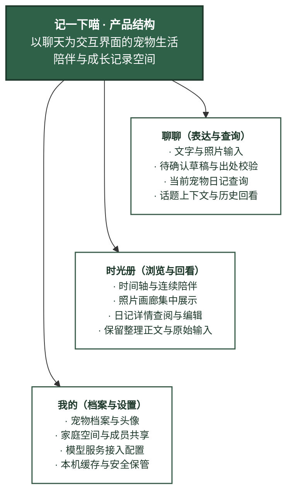
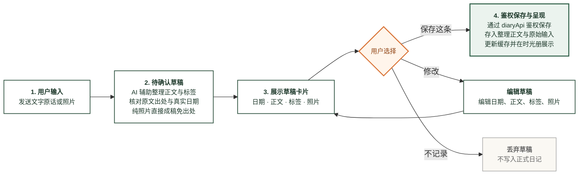
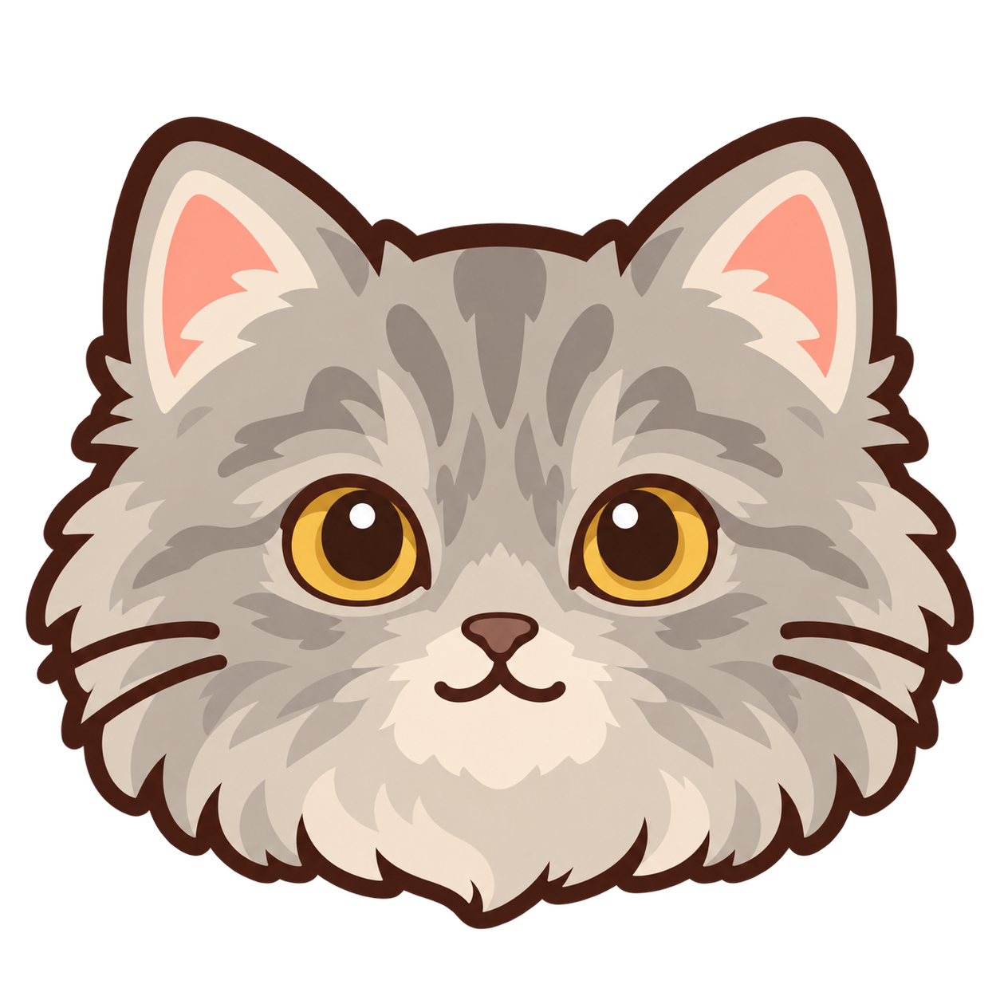
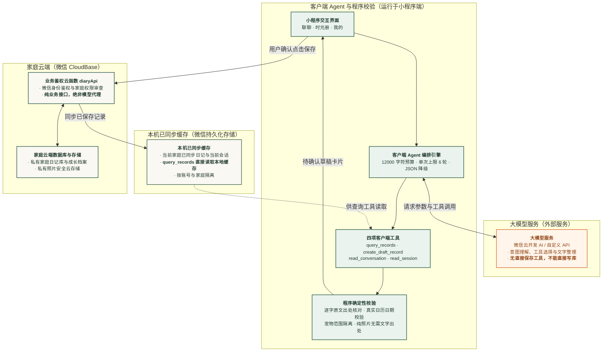

# 记一下喵参赛作品说明

DiandianDiary

通过聊天记录宠物生活，在时间轴与照片画廊里回看陪伴时光。

记一下喵从养猫生活中的两件小事出发：记不清上一次驱虫的日期，以及随手拍下的照片一直没有整理。项目通过聊天输入、用户确认保存和带原记录入口的查询，把零散表达整理成可查找、可回看的宠物日记。

用途：2026 微信小程序开发大赛作品说明

阅读内容：创作背景、产品体验、交互与视觉设计、AI 如何辅助记录与查询、工程实践、验证状态及后续方向。

<!-- pagebreak -->

## 1 从点点的日常开始

点点是我家猫的名字。在和它一起生活的过程中，我有时会忘记上一次驱虫是什么时候。平时也会随手拍它的照片，但这些照片一直没有好好整理。事情发生的时候很清楚，过一段时间，需要找回日期或回看某个瞬间时，就没有那么方便了。

这让我产生了做一个小程序的想法：能不能在事情发生时，像聊天一样说一句，或者发一张照片，就把它留下来？以后想知道上次驱虫的时间，可以直接问；想看看它的日常，可以翻开时间轴或照片画廊。

### 需求与设计回应

| 真实需求 | 产品中的回应 |
| --- | --- |
| 记不清上一次照护事项的日期 | 按当前宠物查询驱虫、疫苗、洗澡等已保存记录，提供原记录入口 |
| 随手拍下的照片缺少整理 | 照片随日记保存，时间轴和画廊共享同一批记录 |
| 希望记录动作尽量轻便 | 以聊天为入口，文字或照片形成草稿，用户检查后保存 |

项目首先服务有类似需求的养宠人；家庭空间进一步支持家人围绕同一只宠物共同记录。它希望让记录成为日常顺手完成的一件事，也让这些记录在以后仍然有用。

<!-- pagebreak -->

## 2 产品结构与使用场景

记一下喵采用三个主入口。聊聊承担表达和查询，时光册承担浏览与回看，我的承担宠物档案、家庭空间和模型配置。常用操作围绕当前宠物展开，减少多只宠物之间的信息混淆。

图 1 产品结构。图示依据当前页面职责整理。

### 随手记录一件小事

用户输入“今天给点点驱虫了”，系统辅助整理正文、日期和标签，展示待确认卡片。用户可以检查、修改或选择不记录。单独发送照片也可以形成纯照片草稿，无需补写一段并不存在的故事。

### 需要时找回之前的记录

用户问“点点上次驱虫是什么时候”，系统在当前宠物已同步的记录中查询，提供日期、距今天数及原记录入口。没有找到匹配记录时，应说明未找到，而不是根据聊天印象补出一个日期。

### 换一种方式回看陪伴

时间轴按发生日期倒序呈现文字与照片，保留竖线和圆点，帮助理解事件先后；画廊集中展示已保存日记中的照片。两种视角共用记录，用户可从日记详情编辑或删除记录。当前没有扫描、自动整理手机全部相册的能力。

本节输入均为功能示例，不代表点点真实发生过的事件或实际测试结果。

<!-- pagebreak -->

## 3 聊天与正式记录的边界

聊天中可能同时出现事实、计划、问题和随口表达。项目将“生成草稿”和“保存日记”分开：模型可以辅助整理，但正式日记只在用户点击“保存这条”后写入。模型没有直接保存、修改或删除正式日记的工具。

图 2 确认保存流程。纯照片草稿没有文字事实需要摘取；用户仍需确认记录日期与照片。

待确认卡片包含日期、正文、标签和照片，提供保存、修改与不记录。日期无法明确解析时留空，由用户补充；保存失败保留重试入口。跨轮指令“把刚才的记下来”应引用用户前文明确说过的事实，不能把助手建议变成宠物经历。

这一设计让用户能在信息进入长期记录前核对内容，也为轻量聊天与可靠归档之间保留了必要的确认步骤。

<!-- pagebreak -->

## 4 交互与视觉设计

整体方向是“清爽耐看，带一点可爱”。界面以暖白为底、深绿为主色，少量杏橙作点缀，减少厚重阴影和重复装饰，让宠物照片与日记正文成为主角。

图 3 聊聊与时间轴的页面布局展示，使用演示内容。

### 聊聊保持容易开始

欢迎区保留品牌小猫和简短邀请文案，快捷入口采用记件小事、上次洗澡、驱虫记录和最近状态等短标题。点击快捷问题先填入输入框，由用户确认后发送。

### 时光册突出照片与正文

竖线和圆点保留时间轴的连续感，日期、相对时间与标签降低视觉重量。单张照片按宽度展示，多张照片使用网格；画廊提供以照片为中心的另一种浏览方式。

### 品牌与宠物身份分开

抱日记本的小猫用于品牌和欢迎区，宠物档案使用宠物照片或内置头像。真实宠物照片表达“这是我的小伙伴”，品牌图表达“这是记一下喵”。头像选择、空状态行动入口、键盘避让和底部安全区都是体验设计的一部分，真机表现仍需持续验证。

<!-- pagebreak -->

## 5 视觉系列与点点原型

我希望记一下喵的视觉能让人感到亲近，同时在不同页面里保持一致。因此，围绕品牌小猫，逐步形成了小程序图标、场景插画和宠物头像这一组视觉系列。

### 品牌小猫与场景插画

小程序图标里的小猫抱着一本日记，呼应“记下日常”的用途。场景插画沿用奶油色猫咪、深棕轮廓和柔和绿色，分别用于时光册无记录、画廊无照片和日记不存在的状态。阅读日记、举起相框和静静等待的动作，让空状态也能与所在页面的含义对应。

### 宠物头像与真实的小伙伴

宠物头像与品牌小猫分工不同：它们用于识别当前正在记录的宠物，因此采用清晰的头部轮廓，便于在小尺寸下辨认。奶油橘猫、灰毛英长和奶油小狗保持相近的线条与配色，同时保留各自的外观特点。

其中，灰毛英长头像以点点为原型，保留了它的灰色长毛、金色眼睛和蓬松脸颊。把熟悉的小伙伴转化为统一画风中的一个角色，也让这个项目有了更具体的个人印记。这组头像在设计过程中使用 AI 辅助生成，再根据画风、辨识度和实际页面用途进行选择与整理。

<!-- pagebreak -->

## 6 AI 如何辅助记录与查询

用户说出宠物的日常，AI 辅助整理成待确认草稿；用户问起过去的事情，AI 调用查询工具找回相关记录。用户可以核对和修改草稿，确认后才保存为日记。以下介绍这些功能在小程序中的实现方式。

AI 负责理解表达、选择工具和整理文字。程序负责核对原文出处、日期、宠物范围、记录统计和引用。当前采用单 Agent 与四项工具，不引入多智能体框架或向量数据库。

图 4 主要职责分区。模型请求由客户端发起；diaryApi 负责身份、家庭与记录业务，并非模型代理。话题读取工具按需读取当前或历史话题，不把聊天内容直接当作已保存日记。

用户可以选择微信云开发 AI 或自定义 OpenAI 兼容 API。两种来源共用草稿与查询校验；明确不支持工具的情形可尝试严格 JSON 降级。额度、权限、网络等错误提示重试，不承诺自动恢复；JSON 模式也不具备完整工具模式的上下文读取能力。

<!-- pagebreak -->

## 7 让事实能够被核对

### 四项工具各有职责

| 工具 | 作用 | 与正式记录的关系 |
| --- | --- | --- |
| query_records | 按事件、关键词与日期查询当前宠物的记录 | 只读已同步记录，生成摘要和引用 |
| create_draft_record | 根据用户明确事实整理待确认草稿 | 不直接保存日记 |
| read_conversation | 分页读取当前话题中较早的消息 | 为理解前文补充上下文 |
| read_session | 按目录读取历史话题 | 不切换当前话题，不代替日记查询 |

### 原文保留与日期校验

生成文字草稿时，模型需要摘取用户事实原文 sourceText。程序检查摘句确实存在于用户消息中，再依据该分句解析日期。正文可以整理语句，但不应补出用户未说过的动作、药名、时长或心情。确认保存后，rawInput 保留原始输入，后续日记编辑不覆盖这份原文，方便回看和对照。

相对日期以原消息的发送日期为参考。例如在 2026 年 10 月 15 日说“昨天”，应对应 10 月 14 日；重新打开旧话题时不会把它改成新一天的“昨天”。两位年份、跨年日期、无效日历日期和多个日期冲突都有单独处理。日期不明确时让用户选择，不自动猜测。

### 查询中的数字由程序生成

查询按宠物、事件或关键词、日期范围筛选，再按发生日期排序。事实摘要中的日期、距今天数、匹配条数和引用由程序生成。例如参考日为 2026 年 10 月 15 日、最新记录为 10 月 12 日时，间隔为 3 天。这里统计的是记录条数，一条日记中可能包含多个事件，因此不能把条数直接当作真实事件次数。

### 上下文按需读取

默认上下文按 12000 字符预算组织，较早消息可以通过工具分页读取；历史话题通过目录按需取回。单次请求最多六轮工具调用，并设收尾机制，控制耗时。会话仍有存储和话题边界，这些设计改善了上下文取用方式，没有承诺无限记忆。

原文存在性校验不能证明所有整理结果的语义都正确。模型推理、否定与计划识别仍可能出错，用户确认和原记录核对仍然必要。

<!-- pagebreak -->

## 8 家庭云端与工程实现

### 围绕同一只宠物共同记录

当前交互需要云端登录和模型配置。确认的日记与照片保存到家庭云端，家庭成员共享同一宠物和日记。创建者可生成 24 小时内有效、仅限一人接受的一次性邀请码；家人复制并粘贴邀请码加入，不依赖扫码流程。

云函数依据微信身份识别用户，并检查当前家庭成员关系。家庭创建者负责宠物与成员管理，普通成员可以新增日记并编辑自己的日记。成员加入、退出等操作使用事务处理；日记照片通过鉴权接口访问。本机缓存按账号与家庭隔离，避免切换身份后混入其他家庭的数据。

针对照片保存中的实际反馈，实现中增加了先授权上传、再确认登记的流程，避免程序内部重复压缩，保留用户选择的文件内容。保存失败时保留草稿和照片，方便重试。这项改进已有自动化回归记录，仍需在真实环境中验证大照片与跨设备显示效果。

成员退出保留其已保存日记；创建者解散家庭后关闭访问，云端数据暂时保留。删除采用逻辑删除，不承诺立即物理清除。当前不支持离线写入、跨设备实时推送或家庭创建者转让。

### 原生小程序与集中数据访问

前端采用原生 WXML、WXSS、TypeScript 与 WebView 渲染，复用 TDesign 微信小程序组件。数据访问层统一处理云端写入、分页读取和缓存，后端 diaryApi 提供身份、家庭、宠物、日记和照片接口。运行时压缩图片与高清设计原图分开管理，文档和设计资源不进入小程序包。

### 模型接入与数据范围

微信云开发 AI 接入无需用户填写 API Key，实际可用性取决于基础库、环境配置和额度。自定义 API 配置保存在本机，当前由客户端直接请求模型；正式分发自定义共享服务前，需要完善服务端代理。模型请求会包含聊天文字和必要上下文，不能把“配置保存在本机”理解为“聊天不上云”。

### 回归与开发测试

项目通过 Jest 与 TypeScript 检查验证逻辑，GitHub Actions 执行依赖安装、类型检查、测试、资源包体和凭据检查。小程序内的开发测试整合首次使用演练、核心自检、聊天流程和脱敏执行日志。核心自检只使用内存数据；真实聊天流程需要用户显式启动，并限定在独立测试家庭和专用测试宠物中。

<!-- pagebreak -->

## 9 实践过程与验证状态

### 从最小记录流程逐步完善

项目首先围绕聊天输入、待确认卡片与时光册建立记录流程，随后完善家庭云端、原始输入保留和私有照片访问。视觉迭代统一三页风格、头像、时间轴和空状态，后续又补齐引导、模型配置、家庭管理与退出登录。当前交互以家庭云端为基础，早期本地验证不代表仍提供独立本机模式。

### 从具体问题改进可靠性

开发中发现了两位年份可能丢失、单纯记录出现冗长回复，以及精确查询混入无关引用等问题。相应修复保留完整日期证据、收紧草稿旁的回复范围，并让可见正文与引用来自同一组查询结果。执行日志与流程测试用于复现问题、核对保存前后状态及新话题中的查询，避免只凭一次对话表现判断效果。

### 当前证据与适用范围

| 项目 | 已有结果 | 验证边界 |
| --- | --- | --- |
| 逻辑与类型检查 | 已有类型检查与逻辑自动化测试通过记录 | 合成数据与模拟传输，不等同真实模型端到端验收 |
| 页面与布局 | 已有 WXML WXSS 编译、窄屏布局和部分模拟器检查记录 | 版面展示不能替代当前真机验证 |
| 云函数 | 既有版本 diaryApi 已部署，记录中状态为 Active，并有源码回读核对 | 新版照片接口尚未部署；数据库规则、索引及双账号业务待核对 |
| 云开发 AI | 已记录一次真实 SDK 基础连接成功 | 完整工具回传、草稿保存与真实模型流程仍需验证 |
| 核心产品能力 | 聊天草稿、记录管理、查询、时间轴、画廊及家庭接口已有实现 | 完整真机流程、照片跨设备及家庭共享仍待验收 |
| 新版照片上传 | 已实现原样上传与登记，新增相关回归 | 待部署新版接口，完成大照片与新格式的真机验证 |

逻辑测试与模拟器检查支持当前实现评估，完整真实模型和真机业务仍需单独验收。代码实现、云端部署、平台发布与真实业务验收分别记录。

<!-- pagebreak -->

## 10 当前边界与后续方向

### 当前能力范围

项目已形成从聊天表达、草稿确认到记录查询与时光册回看的初版流程。照片需要用户主动发送并保存；没有实现手机相册自动整理或照片内容识别。具体事件主要按原文和明确标签匹配，没有语义检索或经过审核的养宠知识库，也没有宠物诊断能力。

同次请求最多生成一张草稿，不同日期的多个事件建议分开记录。日期解析、模型整理和自然语言查询仍可能存在歧义，用户可以回看原文、修改草稿或编辑日记。

### 下一阶段工作

第一步是完成当前流程的验收：核对云端权限与索引，使用独立演示家庭验证双账号共享和照片访问，检查真机键盘、底部安全区、话题恢复，以及真实模型的工具和 JSON 路径。对准备公开使用的版本，还需完善模型服务、隐私说明、内容治理和备份维护。

在基础流程稳定后，再评估陪伴回顾与导出、照片浏览整理等方向。优先围绕现有记录发挥价值，是否增加提醒、知识库或其他能力，应依据实际使用反馈决定。这些方向尚未实现，不作为本次成果。

### 项目希望留下的价值

记一下喵希望让“今天发生的一件小事”更容易被记住。它既回应“上次驱虫是什么时候”这样的具体问题，也为那些普通的照片和日常保留一个回看的位置。点点是故事的起点，而产品希望帮助有相似需求的养宠人保存自己的陪伴时光。
