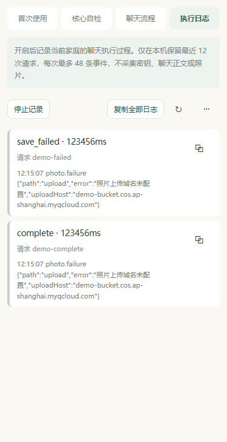

# 精简执行日志操作

日期：2026-10-16。每条请求右上角改为无边框复制图标，保留 44 × 44px 点击区域与「复制本条日志」无障碍名称。事件仍携带当前请求 id，原有单条 / 全部复制、作用域复核、过期提示和系统剪贴板反馈保留。

顶部保留开始 / 停止记录与「复制全部日志」文字，刷新使用图标，清空日志移入更多菜单。打开菜单本身不清空；选择时再次检查开发者模式、家庭登录代次、当前分区及页面代次，切页或切换家庭后的迟到回调不清理当前日志。

类型检查、自检 / 日志 / 跨页相关 70 项测试通过；新增更多菜单与家庭、页面、模式和分区变化保护。微信本机 1 WXML / 2 WXSS 编译通过，320 / 375 / 414px 的普通、长请求 id、空日志与关闭入口共 12 个编译模板 / 浏览器布局检查通过，点击区域、请求 id、顶部按钮及无横向溢出均核对。包体源码估算 1283.0 KiB / 1500 KiB。

预览使用演示日志和近似图标 / 按钮适配，不是微信真机截图；不包含私人正文、凭据或真实云端操作。完整脚本与测量在被忽略的 backups/log-actions-20261016/。独立本地提交，未推送或发布；需更新预览后核对真实图标、系统更多菜单与剪贴板交互，不需要部署 diaryApi。
