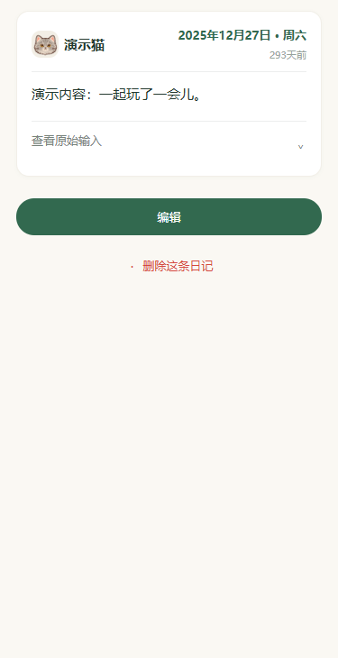
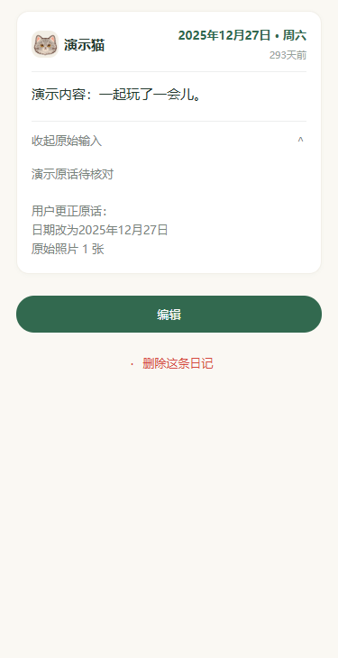

# 按需查看原始输入

日期：2026-10-16。日记详情的原始输入改为默认折叠，点击「查看原始输入」展开，再点「收起原始输入」收起。只修改页面展示状态，不更改 rawInput；完整原话、更正依据、空文字的「仅照片」提示和原始照片数量均保留。旧导入记录使用「查看导入内容」，展开后继续注明原始输入未留存。打开另一条记录、记录失效或家庭不可用时重置展开状态。

顶部、照片、正文、编辑与删除操作沿用，折叠入口至少 44px 高并标记 aria-expanded。验证：类型检查、28 套件 / 517 项全量测试通过，新增展开 / 收起不修改记录及新记录 / 缺失原文状态回归；包体源码估算 1283.8 KiB / 1500 KiB。微信本机 1 WXML / 2 WXSS 编译、24 个三宽度编译模板 / 浏览器布局检查通过，覆盖展开 / 收起、旧导入、纯照片、无原文和长原文；逐张检查两张预览。

| 默认折叠 | 展开核对 |
| --- | --- |
|  |  |

这是编译模板与实际 WXSS 的浏览器适配布局，使用内置头像和合成记录，不是真机截图。图标 / 控件为近似适配；未请求真实模型或云端，也不读取私人日记。完整脚本与数据在被忽略的 backups/original-input-20261016/。独立本地提交，未推送或发布；真实详情页展开、选中文字、编辑与删除的真机体验待更新预览后验证，无需部署 diaryApi。
