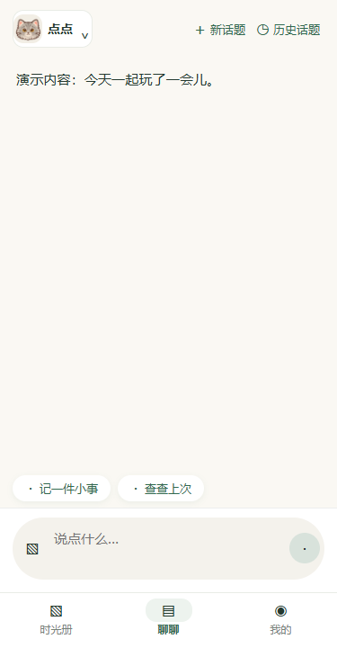
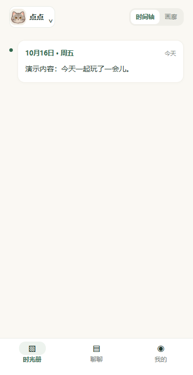

# 宠物按钮与导航留白

> 同日后续：宠物按钮进一步统一位置并改为 32px 等高头像 / 外框，见[最新按钮方案](../pet-switch-compact-2026-10-16/README.md)。下文的 64rpx 头像与上下留白是当时规格，导航安全区与 16px 留白规则继续有效。

日期：2026-10-16。用户明确要求恢复紧凑宠物按钮、保持聊聊与时光册一致，并增加导航底部留白。

- 两页共用 app.wxss 的徽章样式，保留时光册原有 8rpx 纵向内边距、64rpx 头像和长名省略规则；移除聊聊额外左右留白和最小高度。宠物选择、头像来源与右侧操作功能不变。
- 导航内容仍为 112rpx，底部为系统安全区 + 16px。375px 宽安卓总高度 72px、底部留白 16px；iOS 安全区 34px 时总高度 106px、底部留白 50px。页面占位使用同一公共测量结果，键盘弹起的聊聊占位为零。

类型检查、27 套件 / 424 项测试、包体估算 1247.6 KiB / 1500 KiB 通过。本机微信 wcc / wcsc 完成 3 个 WXML / 4 个 WXSS 编译；浏览器渲染编译节点，检查两页 × 三宽度（320 / 375 / 414）× 两种安全区 × 短 / 长名字共 24 个状态，以及三种宽度的键盘态，共 27 个状态。检查短名按钮尺寸与样式一致、长名不重叠、导航底部留白与公共占位一致，以及键盘态没有导航占位。

以下为当前模板、样式的浏览器适配布局展示，使用内存演示文字和仓库内置头像。TDesign 图标为近似占位，不代表真实微信图标；没有读取真实日记、配置、照片或请求网络。截图不包含系统状态栏、原生标题栏和手势条，不能代替真实设备验收。

| 聊聊 · 安卓 375px | 时光册 · 安卓 375px |
| --- | --- |
|  |  |

详细测量见 [layout-results.json](layout-results.json)。实现与文档本地提交，未推送或发布；真机键盘恢复、切页与手势区视觉待验收。两项界面调整只需更新小程序，无需部署云函数。
