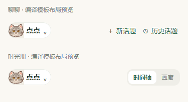

# 宠物切换按钮的位置与紧凑外观

日期：2026-10-16。依据当前实现及用户确认的方向：聊聊与时光册位置统一，头像区域与外框等高，减少按钮的包裹感。

两页新增共享 `pet-toolbar` 和 `pet-switch`。顶部间距为 20rpx、水平间距为 32rpx；按钮视觉高度固定 32px，头像同宽同高、取消原图框的额外 padding，外框统一裁切左侧圆角。名字字号保持 28rpx，图文间距收至 8rpx，箭头收至 24rpx，宽度随名字变化，长名字省略。边框独立覆盖，不缩小头像区域。

视觉框外的切换入口保留至少 44px 高，事件绑定在整块入口上。两页继续使用各自原有的 bindtap / catchtap 和 onSwitchPet；聊聊阻止冒泡的键盘保护保留。没有改变宠物选择、照片 / 内置头像来源、持久化、导航安全区或消息滚动方式。测试家庭中的聊聊工具栏继续参与正常文档流，使用相同间距。

375px 宽度、普通状态、短名字「点点」的浏览器测量：

| 项目 | 聊聊 | 时光册 |
| --- | --- | --- |
| 视觉框左上位置（页面内容区域内） | x=16px，y=16px | x=16px，y=16px |
| 视觉宽 × 高 | 86 × 32px | 86 × 32px |
| 头像区域 | 32 × 32px | 32 × 32px |
| 点击区域高度 | 44px | 44px |

以上是微信 WXML 编译模板及当前 WXSS 的浏览器适配布局展示，使用仓库内置头像与演示内容，不是手机截图。预览不包含原生状态栏、导航标题栏，TDesign 图标为近似占位，不能代替真机验收。完整预览：[聊聊](chat.png)、[时光册](album.png)。

## 验证

- 微信本机 wcc / wcsc 编译通过：两页与导航 3 个 WXML，全局 / 两页 / 导航 4 个 WXSS。
- 42 个浏览器布局状态覆盖 320 / 375 / 414px、短 / 长名字、测试家庭提示条、键盘态，以及猫 / 狗 / 方形演示图片。两页位置与短名宽高一致，头像与外框齐平，右侧操作垂直居中，无横向溢出或重叠，长名字保持省略。
- 从视觉框外的点击留白触发 DOM 事件适配，确认编译节点绑定的是同一个 onSwitchPet；这里只验证点击范围与绑定，不冒充真实微信选择面板验收。键盘态继续取消底部导航占位，输入台贴合缩小后的视口。
- 类型检查、28 套件 / 509 项默认测试与包体检查通过，源码估算 1282.2 KiB / 1500 KiB；逐张检查三张布局预览。

详细数据见 [layout-results.json](layout-results.json)，本机验证脚本与编译产物在被忽略的 backups/pet-switch-compact-20261016/。未调用模型、访问真实业务数据或改变云端。实现与文档独立本地提交，未推送或发布；真机宠物切换、键盘弹收与视觉仍待更新预览后验证，不需要部署 diaryApi。
