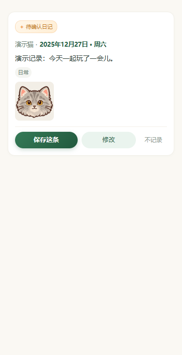
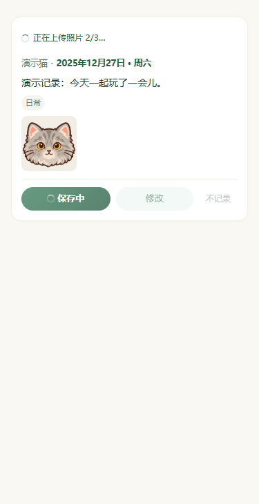

# 精简保存反馈与记录卡

日期：2026-10-16。按用户确认，将正常保存的绿色大面板改为顶部一行状态，去掉重复的「请稍候」。单张上传显示「正在上传照片…」，多张显示真实张数，如「正在上传照片 2/3…」；准备、校验及写入统一显示「正在保存日记…」。实际 stage 保留给日志与失败分类，成功确认后才显示已记入，不模拟百分比。

保存期间底部三个按钮原位保留，显示锁定样式，保存按钮显示 loading；组件与页面原有的操作锁继续阻止重复保存、修改和不记录。错误才展开原因面板与重试入口，已写入但显示失败仍用「确认保存结果」。宠物 / 日期合并为轻量一行，长名字省略、日期完整展示，窄屏允许换行；日期待补充时保留快捷选日及编辑入口。标签弱化底色和内边距，去掉重复 #，标签数据不变。日记编辑 loading 标题共用简短文案。

验证：类型检查和聊天 / 保存反馈 / 正式流程联测 95 项通过，覆盖阶段、真实多张计数、保存锁、重试与确认后保存；包体源码估算 1281.9 KiB / 1500 KiB。微信本机 2 WXML / 3 WXSS 编译、48 个编译模板 / 浏览器布局状态通过，覆盖八阶段、单张、多张、错误、已保存、日期缺失及长信息。320 / 375 / 414px 下保存过程卡片高度及按钮位置与待确认状态一致，无横向溢出，原事件绑定保留；逐张检查三张预览。

以下是编译模板和实际 WXSS 的浏览器适配展示，使用内置头像充当演示照片，不是真机或真实日记；图标为近似占位。保存调用与异常由模拟传输验证，未请求模型、真实云端或读取用户照片。

| 待确认 | 保存中 |
| --- | --- |
|  |  |

失败预览：[分类错误与重试](failed-domain.png)。本机脚本与完整测量在被忽略的 backups/save-card-compact-20261016/。独立本地提交，未推送或发布，无需部署 diaryApi；真机连续保存、错误重试与键盘布局待更新预览后验收。
