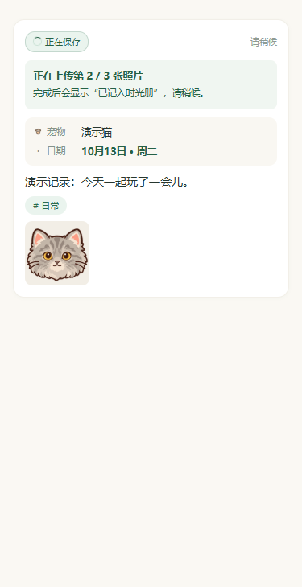
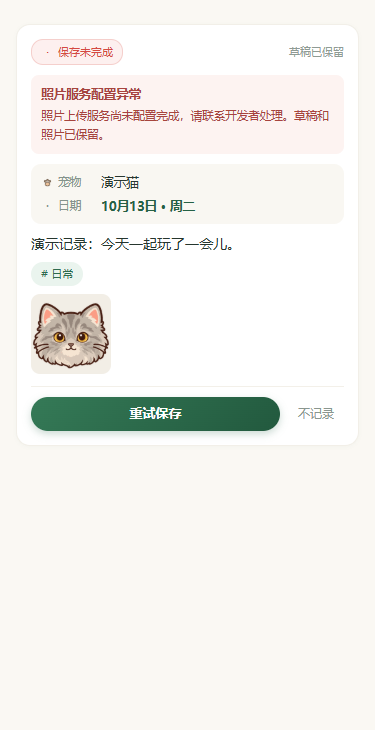

# 保存阶段与失败反馈

日期：2026-10-16。用户提供的真机日志显示一次上传开始后立即失败，另一次约 5.7 秒完成保存。原日志没有保留失败原因，不能据此认定只是等待不足或云端尚未同步。

记录卡显示以下实际阶段：准备 → 读取照片 → 准备上传 → 上传第 N / M 张 → 云端确认 → 照片就绪 → 保存日记 → 显示确认 → 已记入时光册。仅在业务真正完成时显示已保存；当前 PUT 请求没有上传字节进度，不提供模拟百分比。阶段反馈不依赖执行日志开关，不写入持久草稿或聊天消息。

保存期间显示旋转等待标记、阶段和说明，锁住重复保存 / 修改 / 不记录。失败后，分类原因留在当前卡片，并通过可确认的弹窗提示；区分网络中断、超时、上传授权、服务繁忙、配置、格式、过期与写入。日记已写入但刷新照片失败时，明确提示刷新时光册并提供“确认保存结果”，不提示确定未保存，也不展示“不记录”。重试复用同一创建标识，已确认上传的照片复用缓存。

整理结果和原始输入的照片合并去重计数，仍各自保留照片列表。日记编辑入口同步更新等待阶段和分类弹窗。执行日志增加云端确认阶段、固定错误类别、合法 HTTP 状态以及独立保存耗时；不收集 SDK 正文、请求头、URL、签名或私人媒体。

验证：类型检查、28 套件 / 444 项测试、包体估算 1258.8 KiB / 1500 KiB 通过。覆盖实时阶段、防重复操作、失败保留、卸载 / 切宠物迟到回包、照片去重计数、纯文字、反馈回调异常不影响保存、写入后刷新失败的幂等重试，以及分类 / 脱敏。微信本机 wcc / wcsc 完成 2 WXML / 3 WXSS 编译；12 种状态 × 320 / 375 / 414px，共 36 个浏览器布局检查通过，检查提示不溢出、忙碌无可点击操作、失败可重试和成功可查看。

下图使用编译 WXML 节点与当前 WXSS 的浏览器适配，内置头像和内存演示数据；图标为近似占位，不能代替真实微信交互验收。

| 上传阶段 | 配置异常示例 |
| --- | --- |
|  |  |

详细布局测量见 [layout-results.json](layout-results.json)。本轮没有操作真实业务、请求模型、部署云函数或发布体验版。更新小程序即可获得新反馈，原上传失败的实际原因仍需新日志及真机验收确认。
